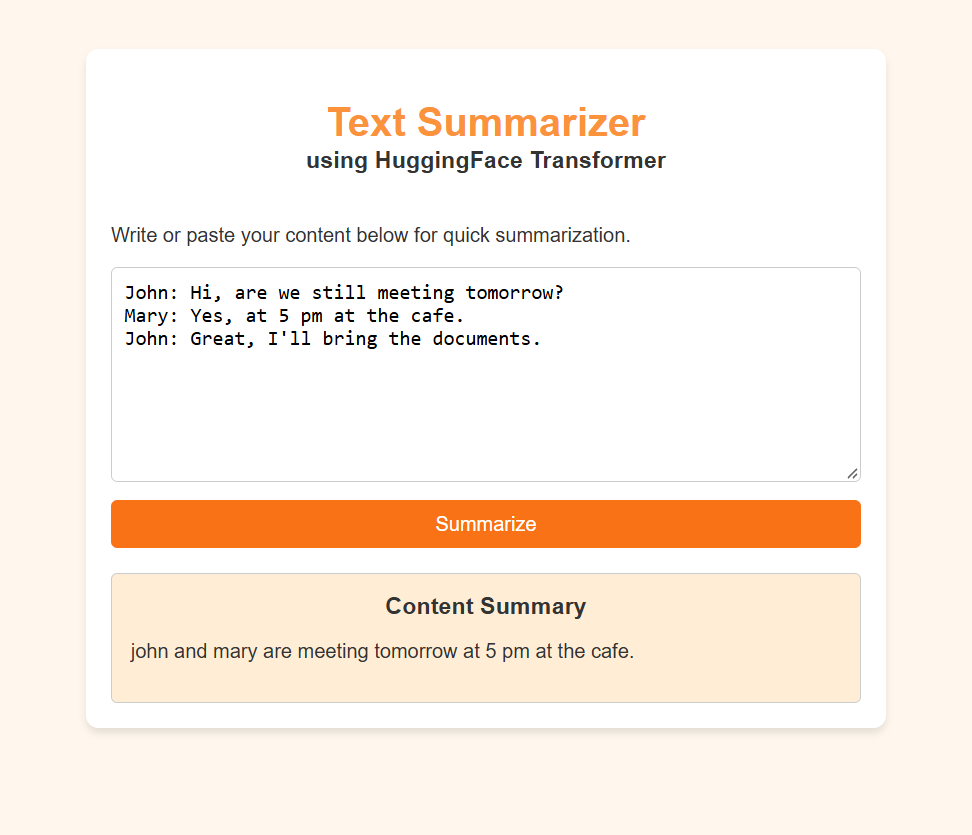

# Text Summarizer App

A web app that summarizes dialogues and conversations using a fine-tuned **T5** transformer model. The model is trained on the SAMSum dialogue dataset and served with **FastAPI**, with a simple HTML/CSS/JavaScript interface.

## Features

- Paste a conversation and get a short summary
- Fine-tuned T5 model (Hugging Face Transformers + PyTorch)
- REST API endpoint (`POST /summarize/`)
- Simple web UI built with Jinja2 templates
- Runs on GPU (CUDA or Apple MPS) when available, otherwise on CPU

## Tech Stack

- Python
- FastAPI and Uvicorn
- Hugging Face Transformers and PyTorch
- Jinja2, HTML, CSS and JavaScript

## Project Structure

```
TEXTSUMMARIZERAPP/
├── app.py                  # FastAPI app and model loading
├── templates/
│   └── index.html          # Web interface
├── static/
│   └── style.css           # Styling
├── text_summarizer.ipynb   # Model training notebook
├── requirements.txt
└── saved_summary_model/    # Fine-tuned model (not included in the repo)
```

## Setup

1. Clone the repository:
```bash
git clone https://github.com/Vineet4265/Text-Summarizer-App.git
cd Text-Summarizer-App
```

2. Install the dependencies:
```bash
pip install -r requirements.txt
```

3. Add the model. The trained model is not stored in this repo because of its size. Train it with `text_summarizer.ipynb`, save it to a folder named `saved_summary_model`, and place that folder next to `app.py`.

4. Start the server:
```bash
python -m uvicorn app:app --reload
```

5. Open http://127.0.0.1:8000 in your browser.

## Usage

1. Paste a dialogue into the text box, for example:
```
John: Hi, are we still meeting tomorrow?
Mary: Yes, at 5 pm at the cafe.
John: Great, I'll bring the documents.
```
2. Click the button to generate the summary.

### API

**POST** `/summarize/`

Request body:
```json
{ "dialogue": "John: Hi, are we still meeting tomorrow? Mary: Yes, at 5 pm." }
```

Response:
```json
{ "summary": "..." }
```

Interactive API docs are available at http://127.0.0.1:8000/docs.

## Screenshots



## Future Improvements

- Deploy the app online
- Upload the model to Hugging Face Hub
- Add support for longer documents and summary length options

## Author
Vineet Kumar

GitHub: https://github.com/Vineet4265

LinkedIn: https://www.linkedin.com/in/vineet-kumar-b08a90239/
